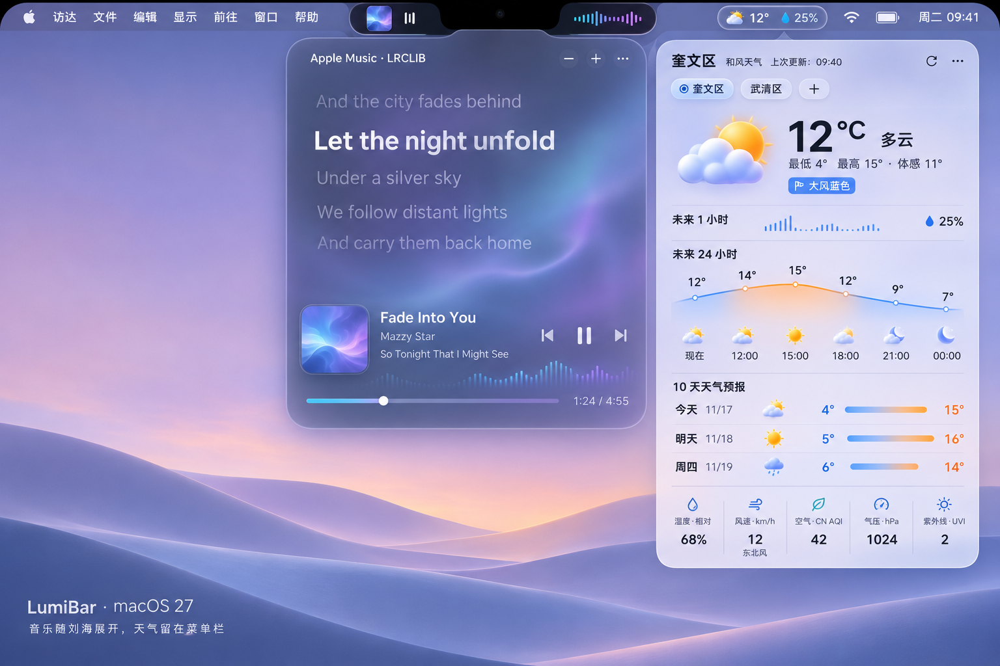

# LumiBar Mac 移植交接

2026-11-19 更新。目标系统：macOS 27。Windows 视觉基准：0.7.56 内置前端。制作人：Ma Guanqun with Codex。

先读 [Mac 视觉还原包](outputs/Mac前端还原包/README.md)：14 张实机参考、实际尺寸、字体、配色、动效、模拟数据、资源哈希和 Mac 分支差异清单。本次明确采用 **Mac 入口 + Windows 浮窗风格**；天气胶囊本身也尽量还原。音乐入口围绕刘海重新排布，歌词和天气详情保持内置版的视觉体系。

## 已选定的方向

音乐围绕 MacBook 的刘海做灵动岛式界面，天气单独放在右侧系统菜单栏。Mac 原生工程目前位于 `codex/macos-port` 分支；在 Mac 上继续构建和实机校准。浮窗按最新还原包核对，根目录早期 DESIGN.md 与概念图用于补充方向。



这张图同时展示两种浮窗的展开态，方便比较布局。天气数值、歌曲与歌词是视觉示例，字体、控件及具体动效在实机适配时继续打磨。

## 音乐岛

- 使用原生顶部浮层，按屏幕刘海安全区域计算两侧可用空间。摄像头区域留空。
- 收起时左侧显示封面，右侧显示频谱；封面提取两个相近亮色，形成克制的渐变光效。
- 悬停向下展开歌名、歌手和播放控件；点击展开歌词和完整专辑信息。
- 暂停保留音乐岛，停止频谱活动；媒体会话结束后淡出。
- 沿用逐曲保存的歌词偏移、±0.5 秒快捷按钮、长歌名滚动及渐隐。
- 外接显示器或无刘海屏采用顶部居中的独立音乐岛。全屏、菜单栏自动隐藏、Spaces、睡眠唤醒和切换主屏都纳入实机检查。

## 天气菜单栏胶囊

- 使用 NSStatusItem 或等价原生菜单栏入口，由系统安排图标位置。
- 彩色天气图标、温度，以及更小的降水图标和概率；空间紧张时优先收紧内容。
- 悬停显示城市、实际温度、体感、未来一小时降水和空气质量的图文速览；点击展开完整天气详情。
- 保留系统定位、手动城市搜索、收藏切换、刷新、更新时间与来源、逐时与逐日预报、相对湿度、风向风速、空气质量、气压、紫外线和天气预警。
- 光效在天气图标附近的背景层扩散，图标本身保持干净；浮窗背景、内容和阴影同步淡出。

## 源码参考与平台接入

- `work/LumiBar/Backend`：天气数据处理、封面配色、FFT、歌词时间轴、配置与策略，优先复用逻辑及测试用例。
- `work/LumiBar/Models.cs`：天气、曲目、歌词与偏好数据模型。
- `work/LumiBar/WeatherService.cs`、`WeatherProxyClient.cs`：天气代理和备用来源。代理密钥留在服务端。
- `work/LumiBar/MediaService.cs`、`SpectrumService.cs`：Windows 媒体和采样实现，Mac 端分别接播放器及 Core Audio。
- `work/LumiBar/CapsuleWindow.cs`、`MusicWindow.cs`、`WeatherWindow.cs`：内置界面行为参考。
- `outputs/Antigravity前端接入包`：协议、菜单和前端生命周期的现有约定；Named Pipe、HWND、WinUI、Win2D、TaskbarBridge 属于 Windows 接入层。
- `work/frontends/antigravity`：正在迭代的独立 Synthwave 前端。当前配置 v7、歌词浮窗默认 512×384；Mac 界面以本页的刘海与菜单栏设计为准。

Mac 端建议采用 SwiftUI + AppKit：NSPanel 管浮层和焦点，NSScreen 提供刘海安全区域，NSStatusItem 管天气入口；Core Audio taps 负责频谱，播放器适配逐个验证 Apple Music、Spotify、网易云、QQ 音乐与浏览器。

## Mac 上开始

登录有权访问本私有仓库的 GitHub 账号，然后克隆：

```sh
git clone https://github.com/mgqlfc/LumiBar.git
cd LumiBar
```

如果已经克隆且本地改动已提交，在 Mac 工作分支合入参考资料：

```sh
git fetch origin
git switch codex/macos-port
git merge origin/main
```

在 Mac 上安装支持目标 SDK 的 Xcode。先按还原包固定字体、栅格、图标、圆角和图层，再打磨材质与动效，最后检查真实天气、播放器、音频权限、多屏、全屏和自动隐藏行为。Mac 构建与打包入口见该分支 `work/LumiBarMac/README.md`；Windows 打包脚本仍生成 Windows x64 EXE。保留 Mac 上的本地代码和工作分支，先保存改动再合并。

## 同步范围

仓库同步源码、设计、协议、公开部署模板与已授权保留的字体。各设备独立保存登录、API 配置、城市收藏、歌词缓存和个人设置。字体的私有开发约定见 [DISTRIBUTION.md](DISTRIBUTION.md)。
