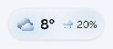
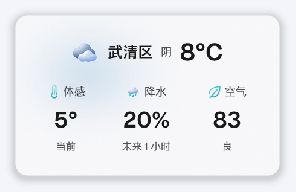

# LumiBar Mac 视觉还原包

2026-11-19。目标：**Mac 的入口，Windows 内置版的浮窗风格；天气胶囊也尽量还原。**

音乐入口围绕刘海重排，保留封面、取色、频谱与交互；天气入口在右侧菜单栏，保留完整天气胶囊的图标、温度和小号降水信息。天气详情、速览、歌词和设置以本包的 Windows 0.7.56 实机参考为准。

## Mac 上的 Codex 从这里开始

1. 读 [当前视觉规范](VISUAL_SPEC.md)，然后读 [Mac 分支差异清单](MAC_GAPS.md)。
2. 加载 [visual-tokens.json](visual-tokens.json)、[fixtures.json](fixtures.json) 和 [reference-manifest.json](reference-manifest.json)。
3. 用同一套样例数据打开 Mac 界面，对照下方 PNG，按 [验收清单](CHECKLIST.md) 逐项修正。
4. 在 Mac 上构建、截屏、检查悬停/关闭/城市展开和逐句歌词滚动，再接回真实数据。

资料优先级：本次用户要求 → 当前 `work/LumiBar` 控件与本包实机参考 → Mac 刘海/菜单栏概念图 → 根目录早期 `DESIGN.md`、`work/ConceptUI` 及历史概念图。`work/frontends/antigravity` 是另一个 Synthwave 前端，不作为本次玻璃浮窗的视觉来源。

根目录 `DESIGN.md` 记录 11 月 14 日的早期状态，包含旧字体、旧玻璃参数、旧模块排列和旧交互。不要把其中的数值覆盖到本包。当前规范逐项保留源码出处，资源和控件的文本哈希按 LF 换行校验，Mac 克隆后可直接核对。

## 实机对照图

这些图片来自真实 WinUI 控件的隔离预览，不是 AI 概念图。采用模拟城市、预报、封面、歌词和固定频谱；不读取私人播放历史，不连接播放器控制。玻璃下方统一铺浅色 `#F3F5FA` / 深色 `#171922` 临时底板。截图时关闭动画，动效按规范中的时长实现。

| 部件 | 浅色 | 深色 |
|---|---|---|
| 标准天气胶囊 | [PNG](references/weather-capsule-light.png) | [PNG](references/weather-capsule-dark.png) |
| Lite 天气胶囊 | [PNG](references/weather-lite-light.png) | [PNG](references/weather-lite-dark.png) |
| 天气悬停速览 | [PNG](references/weather-hover-light.png) | [PNG](references/weather-hover-dark.png) |
| 天气详情 | [PNG](references/weather-light.png) | [PNG](references/weather-dark.png) |
| 音乐歌词详情 | [PNG](references/music-light.png) | [PNG](references/music-dark.png) |
| 设置外观页首屏 | [PNG](references/settings-light.png) | [PNG](references/settings-dark.png) |
| −20° / 100% 宽内容 | [PNG](references/weather-wide-light.png) | — |
| 两条预警 | [PNG](references/weather-alerts-light.png) | — |

每张图旁边有同名 JSON，记录实际窗口像素尺寸、XAML 比例、内容 DIP 尺寸和样例参数。PNG 来自 Computer Use 的窗口截图，已按逻辑尺寸归一；不要再按 Windows 的 1.65625 倍放大。具体映射见 manifest。





## 同步到 Mac 工作分支

Mac 原生源码目前位于 `codex/macos-port`。先让 Mac 上的 Codex 检查并保存本地改动，再 fetch 并合入 `origin/main` 的资料更新。保留 Mac 分支和正在开发的文件，避免用 Windows 工作区覆盖它们。

可直接交给 Mac 上的 Codex：

> 请先读 `outputs/Mac前端还原包/README.md`、`VISUAL_SPEC.md`、`MAC_GAPS.md`、`visual-tokens.json` 和参考 PNG。入口沿用 Mac 刘海音乐岛、右侧菜单栏天气；天气胶囊也尽量还原 Windows 版，保留小号降水图标和概率。天气详情/速览、音乐歌词和设置按本包还原，别用早期 DESIGN.md 或 Synthwave 插件替换风格。先用 fixtures.json 对齐字体、尺寸、栅格和层级，再打磨材质及动效。保留当前 Mac 改动，在 Mac 上构建和截图对照；列出仍有差异的具体部件及对应图片，不把“能运行”当作视觉完成。

## 校验与重新采集

在仓库根目录运行：

```sh
python3 outputs/Mac前端还原包/tools/verify_reference.py
```

Windows 可用 `reference-preview/start-reference.ps1 -Build -Case weather -Theme Light` 重建隔离预览，再通过 Computer Use 获取窗口截图。预览只复制源码到忽略的 `work/mac-reference-preview`，保持正式程序和个人设置。支持的样例由脚本 ValidateSet 列出；关闭用同一 Case/Theme 加 `-Stop`。

本包交付参考资料和差异清单；Mac 新一轮还原由 Mac 工作区接续。14 张 PNG 覆盖静态外观，动画和十天展开/收起需按规范在 Mac 实机检查。
